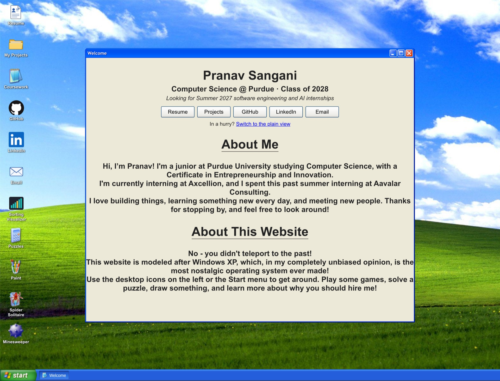
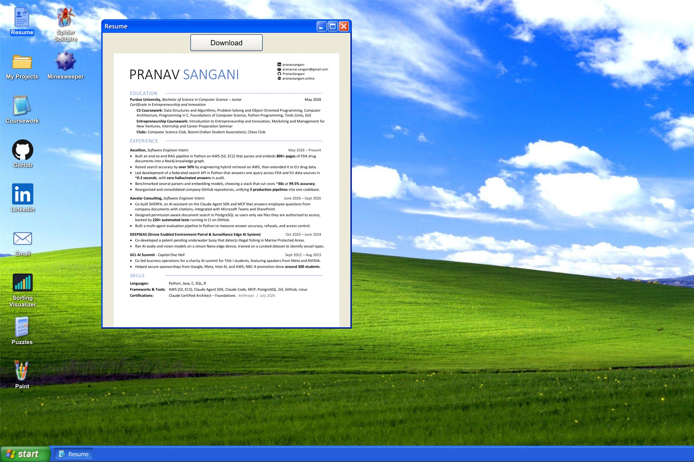
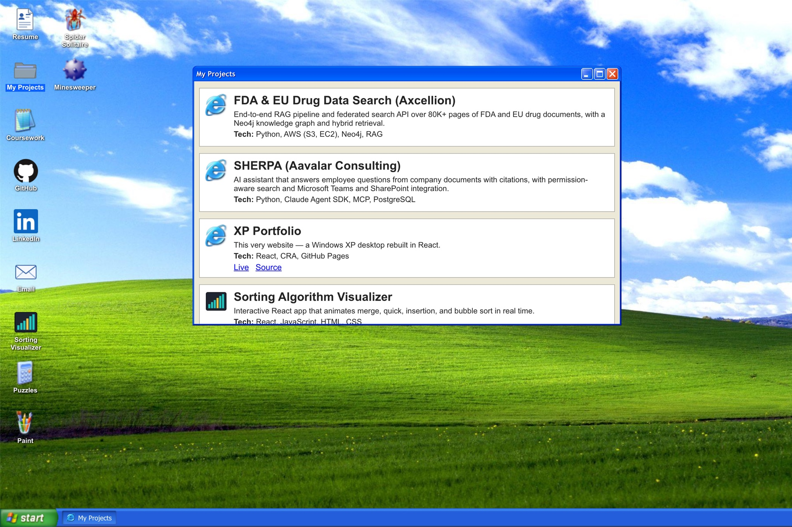
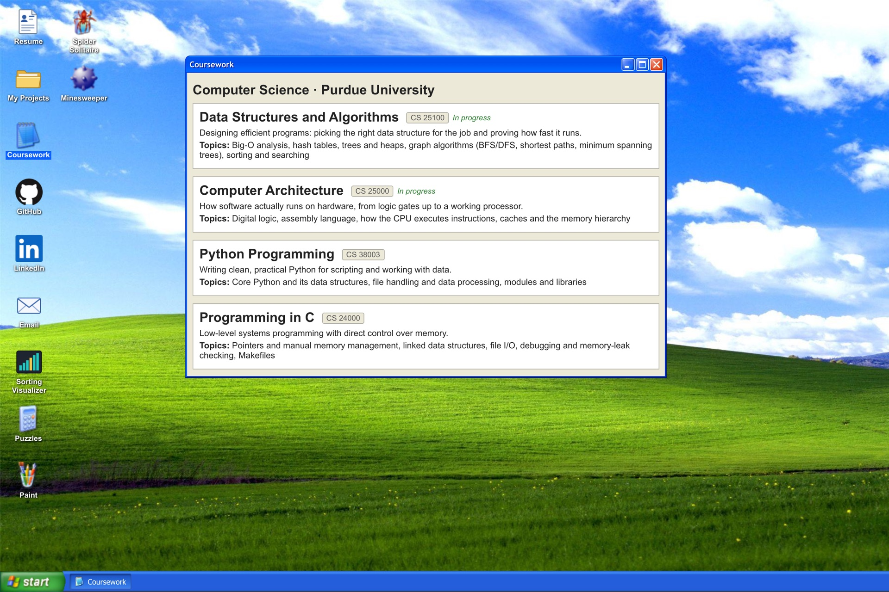
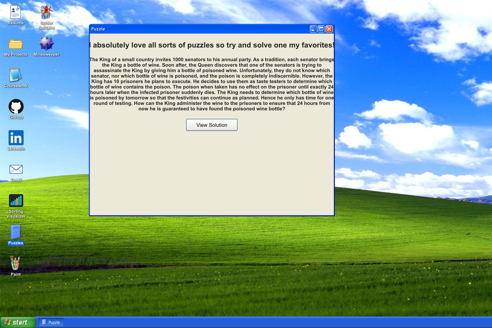
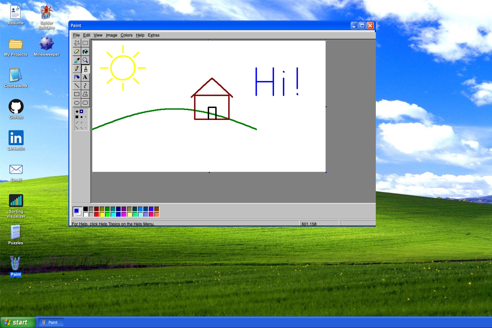
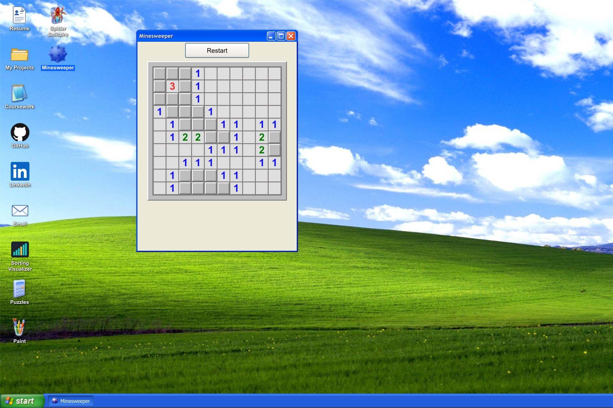
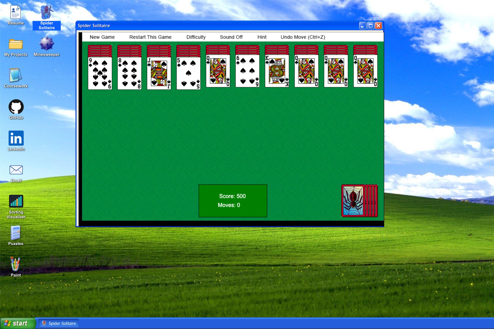

# Visit the website at https://pranavsangani.online

# About
I created this website with React to mimic Windows XP, which, in my completely unbiased opinion, is the most nostalgic
operating system ever made. There are links to my resume, projects, coursework, GitHub, LinkedIn, and email, along with one of my
favorite puzzles, classic MS Paint, Spider Solitaire, and Minesweeper (both of which I have spent hours on hours playing
as a child). Building this website was a ton of fun and made me very nostalgic - hope you enjoy it as much as I do!

# Credits
For both Spider and Paint, I am using an iframe component that goes to their
websites: https://www.squidbyte.com/games/spidersolitairewindowsxp/ and https://jspaint.app respectively.
